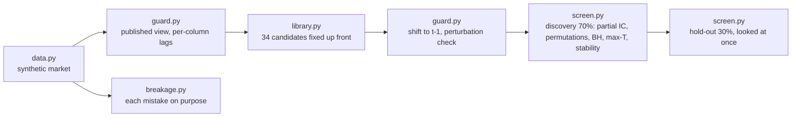

# Feature Factory

[](https://github.com/Avinash186200/feature-factory/actions/workflows/ci.yml)  [](LICENSE)

A small, repeatable way to generate many candidate predictive features, prove each one only uses information that was available, and screen them without fooling yourself through multiple testing.

This is a research project I designed and mentored. I wrote the brief and the starter code. The brief had two goals: new candidate features, and, more important, a pipeline that proposes and screens candidates the same way every time instead of adding them by hand. This repo is my own working implementation of the pipeline. It runs end to end on a **synthetic market with known, planted structure**, so you can see what the screen finds, what it wrongly lets through, and how the hold-out catches it.

## Watch

- Video walkthrough: [Data Pipelines for AI: Point-in-Time Data, Look-Ahead Bias](https://youtu.be/RcC7qz3XHdY)
- Video walkthrough: [Combinatorial Purged CV, Deflated Sharpe and PBO Explained](https://youtu.be/6KIUmIWWHMQ)

## What problem this solves

A quant researcher can invent hundreds of candidate features. Test enough of them and some will look predictive by pure luck, and some will look predictive because they quietly use data from the future. This repo builds candidates in a fixed, repeatable way, rejects any that peek at later data, and screens the rest with tests that account for how many were tried.

## What you will learn

- How to write features that are point-in-time by construction, and how to *test* that they are.
- How publication lags work, and how ignoring one turns noise into a great-looking feature.
- What an information coefficient (IC) is, and why a partial rank IC against a persistence baseline is fairer.
- Why a naive p < 0.05 rule fails when you test many features, and how FDR and family-wise control fix it.
- Why a circular-shift permutation test suits slow-moving time series better than a plain shuffle.
- How to keep a hold-out honest: select on discovery, look at the hold-out once.
- How large each classic leakage mistake really is, measured on the same data.
- How fractional differentiation trades memory for stationarity, and how to pick the order d without peeking.

## Key concepts

- **Feature:** a number computed from past data that might predict the next return.
- **Point-in-time data:** a value placed on the date it became known, not the date it refers to.
- **Publication lag:** the delay between a value's reference date and its release. Here `macro` arrives 2 business days late.
- **Look-ahead bias:** using data that was not yet available at the decision time.
- **Same-bar leakage:** using day t's own bar to predict day t's return.
- **Information coefficient (IC):** the rank correlation between a feature and the next return.
- **Partial IC:** the IC after removing what yesterday's return already explains.
- **Multiple testing:** testing many hypotheses at once, which makes lucky passes almost certain.
- **False discovery rate (FDR):** the expected share of selected features that are false. Controlled here with the Benjamini-Hochberg (BH) step-up rule.
- **Family-wise error (max-T):** the chance of even one false selection. Stricter than FDR.
- **Permutation test (circular shift):** slide the feature against the target in time to build a "no relationship" null, while keeping each series' own autocorrelation.
- **Stability:** the IC keeps the same sign across sub-periods.
- **Discovery / hold-out split:** choose features on the first 70%, then check them once on the last 30%.
- **Fractional differentiation (FFD):** `(1 - B)^d` with `0 < d < 1`, a transform between the price level (d = 0) and the return (d = 1), computed over a fixed trailing window.
- **ADF test:** the augmented Dickey-Fuller test for a unit root. A statistic below the 5% critical value is read as stationary.

## At a glance

| | |
|---|---|
| **Input** | Daily `open, high, low, close, volume`, a second asset `close_b`, and a `macro` series published with a lag (synthetic, same shape as a real daily panel) |
| **Method** | A pre-registered grid of 34 candidates (transforms x inputs x windows, plus interactions), a leakage guard, partial rank IC against a persistence baseline, a circular-shift permutation test, BH step-up FDR control plus family-wise max-T, a stability filter, and one look at a hold-out |
| **Output** | A feature catalogue (IC, p, q, family-wise p, stability, hold-out IC, selected or not) and a breakage study that measures how much each classic mistake inflates the result |
| **Leakage controls** | Every feature at t is built from data published by t-1, and a perturbation check rejects any feature that reads later data. Publication lags per column. Discovery and hold-out split. Noise test in CI |
| **Status** | Framework complete and tested on synthetic data. No real-data claims |

## How it works



In plain text: data -> published view -> candidate grid -> guard -> screen (discovery) -> hold-out, with the breakage study run beside it.

1. **Generate.** `library.py` builds every candidate up front: momentum, volatility and vol ratios, volume z-scores, range, close location, distance from moving averages, cross-asset correlation and relative momentum, macro changes and level, and six pairwise interactions. The full count is known before any test is run, so the multiple-testing correction covers all of them.
2. **Guard.** `compute` moves each column to the row on which it was published (`macro` arrives 2 days after its reference date), runs the feature function, and shifts the result by one row. The feature on row t therefore uses data up to t-1. `check_no_lookahead` then verifies this rather than trusting it: it scrambles every input not yet published at t-1 and checks that the value at t does not move. A hidden centred window, `shift(-k)` or full-sample statistic fails, and the candidate is rejected before screening.
3. **Target.** Day t's return divided by trailing volatility known at t-1.
4. **Screen** (first 70% of the sample only):
   - **Partial rank IC**: rank-transform each feature and the target, and remove yesterday's return from both, so the IC measures information beyond simple persistence.
   - **Circular-shift permutation p-value**, 500 shifts. Shifting keeps each feature's own autocorrelation, which a plain shuffle would destroy.
   - **BH step-up FDR q-value** across all 34 candidates, and a **family-wise max-|IC| p-value** from the same shifts applied to all features at once.
   - **Stability**: the IC has the same sign in at least 3 of 4 sub-periods.
   - `selected` = q <= 0.10 and stable. `strict` = also family-wise p <= 0.05.
5. **Hold-out** (last 30%): the partial IC of every candidate, looked at once, after selection.

## Results on synthetic data

Every number in this section comes from the synthetic market, with structure I planted on purpose. None of it is a real-market result.

`python scripts/run_screen.py` (seed 7, 2,500 days, planted signal 0.15). The planted driver is the 5-day volume z-score.

| Rule | Selected | Contain the planted driver | False | Hold-out IC (planted / false) |
|---|---|---|---|---|
| Naive p < 0.05 | 10 | 5 | 5 | n/a |
| BH q <= 0.10 + stable | 8 | 5 | 3 | 0.137 / -0.005 |
| Also family-wise p <= 0.05 | 4 | 4 | 0 | 0.142 / none |

What this shows:

- The naive rule is half wrong. With 34 candidates, a 5% threshold is expected to pass one or two by luck. Correlated features cluster, so in practice it passed five.
- FDR control is a candidate list, not a verdict. At q = 0.10 the three false picks (`clv_1`, `volratio_21_63`, `macro_chg_21`) got through. FDR is a rate in expectation, so one run can be worse. All three collapse to about zero on the hold-out, while the planted features keep an IC of 0.11 to 0.16. I checked `clv_1` on a 20,000-day sample, and its true IC there is about zero.
- The family-wise max-T rule picked only true features here, at the price of missing `volume_z_21`.
- **Noise check**: `python scripts/run_screen.py --signal 0 --macro-trap 0` switches both off. At seed 7 the naive rule still passes 6 features, while BH and max-T select none. With `--signal 0` alone the macro trap stays on, and at seed 7 BH selects `macro_chg_21`. Over 20 seeds with both off, over 20 seeds, BH selected something in 3 runs and max-T in 1, close to their 10% and 5% levels. A CI test checks that a null seed selects nothing.

**Breakage study**: each classic mistake made on purpose, with partial rank IC over the whole sample:

| Mistake | IC wrong | IC right | Guard flags it |
|---|---|---|---|
| Same-bar data (day t's bar for day t's return) | 0.782 | -0.055 | yes |
| Macro value used on its reference date, not its release date | 0.221 | 0.002 | yes |
| Centred 5-day window instead of trailing | 0.474 | 0.045 | yes |
| Full-sample z-score instead of trailing | 0.025 | 0.008 | yes |

The first three mistakes turn noise into an apparently excellent feature. The full-sample z-score barely moves a **rank** IC, because it is close to a monotone transform. It matters once a model or a fixed threshold consumes the values, and the guard flags it either way.

## Fractional differentiation: memory vs stationarity

A price level remembers its whole history, but it is not stationary, so its statistics drift and a model fitted on one period does not carry to the next. The return (the first difference) is stationary, but it has thrown almost all of that memory away: on the synthetic close below, the return's correlation with the log price level is 0.03. Fractional differentiation, `(1 - B)^d` with `0 < d < 1`, sits in between. The aim is the smallest `d` that passes a stationarity test, which keeps the most memory.

`fracdiff.py` has:

- `ffd_weights(d, threshold)`: the weights from the recursion `w_0 = 1`, `w_k = -w_{k-1} (d - k + 1) / k`, cut once `|w_k|` falls below `threshold` (default 1e-4). That gives a **fixed-width window** (FFD), so every value uses the same number of past rows.
- `frac_diff_ffd(series, d)`: the transform. The value on row t reads rows t - width + 1 to t only. d = 0 returns the series and d = 1 the first difference, exactly.
- `adf_test(series)`: an ADF test in numpy (statsmodels is not a dependency). Constant term, lag count by AIC, critical values from MacKinnon (2010). I checked it against `statsmodels.tsa.stattools.adfuller(..., regression="c", autolag="AIC")` on random walks, white noise and AR series: the statistic, lag and critical values matched. A test repeats that check when statsmodels is installed and is skipped otherwise (CI does not install it).
- `min_ffd_d(series)`: tries d = 0, 0.05, ..., 1 and returns the smallest d from which every larger d passes the 5% ADF test, with a table of the window width, the sum of the kept weights `sum_w`, the ADF statistic and the correlation with the original series for each d. Near the boundary the ADF statistic is noisy, so a single pass below a failing d is not taken.
- `fracdiff_feature(column, d)`: the transform as a `Feature`, so the guard shifts it to t-1 and perturbation-tests it like any other candidate.

**Point in time.** The weights only touch past rows, and a test perturbs future values and checks that earlier outputs do not move. The choice of d is itself a fitted setting, so the script chooses it on the discovery period (first 70%) only. The guard also fails a feature that is NaN on every probe row, since then nothing was compared: a window longer than the data could otherwise hide a `shift(-k)` (tested).

**What the truncated window leaves behind.** The full, infinite-window expansion has weights that sum to zero for any d > 0, so the level cancels out. The fixed window cuts the tail, the kept weights sum to `sum_w` > 0, and the output still carries `sum_w` times the level of the series. With the default threshold, `sum_w` is 0.72 at d = 0.05, 0.15 at d = 0.28 and 0.053 at d = 0.45 (the script prints it for every d).

`python scripts/run_fracdiff.py` (seed 7, synthetic data, threshold 1e-4; the full table for every d is printed):

| Series (discovery rows only) | min d | Window (rows) | sum_w | ADF stat at min d (5% critical) | Corr with original at min d | Corr at d = 1 |
|---|---|---|---|---|---|---|
| log close | 0.45 | 238 | 0.053 | -3.33 (-2.86) | 0.696 | 0.032 |
| macro, as published | 0.30 | 388 | 0.129 | -3.26 (-2.86) | 0.844 | 0.047 |
| plain random walk, seed 7 | 0.05 | 362 | 0.722 | -3.31 (-2.86) | 0.992 | -0.026 |

Over 20 seeded random walks (seeds 0-19) the min d had a median of 0.28 (`sum_w` 0.15) and a range of 0.05 to 0.40; the search returned a value for all 20. The guard check passes for `ffd_close_0.45`.

What this shows, and what it does not:

- **The random-walk results show how weak the test is, not memory being kept.** For a random walk the infinite-window transform is stationary only for d > 0.5. Every random-walk min d here is below that (0.05 at seed 7, median 0.28), so each of those outputs still carries a share of the non-stationary level (72% at d = 0.05) that the ADF test fails to detect on a truncated, shorter sample. The seed 7 walk is the extreme case: its level is already close to the boundary (statistic -2.83 at d = 0), and the 362 rows lost to the window change the sample being tested.
- The synthetic close is itself close to a random walk, so the same caution applies to its d = 0.45: part of its 0.70 correlation with the price level comes from the 5% of the level the window leaves in. The transform keeps far more of the level's shape than the return does (0.03), but read the correlation together with `sum_w`.
- For macro, d = 0.20 passes (-2.93) but d = 0.25 just fails (-2.86), so the rule picks 0.30. That is the boundary noise the "every larger d passes" rule guards against.
- The threshold matters: `--threshold 1e-3` keeps shorter windows (44 rows at d = 0.5), and the kept weights leave more of the level in (`sum_w` 0.086 at d = 0.5, against 0.040 with the default). The log close needs d = 0.50 there and shows a higher correlation (0.83). Report the threshold with the d.
- FFD features are **not** added to the 34-candidate grid, so the screen results above are unchanged. Adding them is one line (`fracdiff_feature("close", d)` in the candidate list), and they then count towards the multiple-testing total like any other candidate.
- Stationarity is not predictiveness. On this synthetic market nothing is planted in the price level, so an FFD feature should not be expected to screen in.

## Leakage and bias audit

| Issue | Effect | Fix |
|---|---|---|
| The starter feature contract declared `knowable_at` but nothing enforced it, and the target alignment was undefined | A feature knowable at t's close could be used to predict day t's own return (same-bar) | `compute` shifts to t-1, and `check_no_lookahead` perturbation-tests every candidate; the screen rejects failures |
| No handling of publication lags | Macro data matched to its reference date: IC inflated from 0.00 to 0.22 in the breakage study | Per-column `pub_lags`, applied before any feature is computed; tested |
| The starter screen was a plain Spearman IC over the whole sample, with no correction | With 34 candidates, a naive 5% rule passed 10 here, 5 of them false | Partial IC, permutation p-values, BH and family-wise control, a stability filter, a discovery/hold-out split |
| The IC was not measured against a persistence baseline | Features that only restate yesterday's return look predictive | Yesterday's return is removed from both feature and target ranks |
| A naive i.i.d. significance test on autocorrelated features | p-values too small for slow-moving features | Circular-shift permutation keeps each feature's autocorrelation |
| (Found while building this) a raw-return target is heteroskedastic, and vol-like features line up with its variance | The shift null gets narrower than the true spread. Over 20 null seeds, BH falsely selected something in 4 with raw returns, against 3 with vol-scaled returns. A modest effect, but in the wrong direction | Target is the return scaled by trailing (t-1) volatility |
| The starter test used unseeded random data | Non-reproducible | Every generator and test is seeded |

## Repo layout

```
src/featurefactory/   data.py (synthetic market) · guard.py (point-in-time guard) · library.py (candidates)
                      screen.py (IC, permutations, BH, max-T, hold-out) · breakage.py (mistakes on purpose)
                      fracdiff.py (FFD weights and transform, numpy ADF test, min-d search, guarded feature)
scripts/              run_screen.py (the CLI that prints the screen tables) · run_fracdiff.py (the min-d tables)
tests/                test_factory.py: guard (good and bad features, publication lag), BH, hold-out isolation,
                      noise, signal, breakage
                      test_fracdiff.py: weight recursion, d = 0 and d = 1, no look-ahead, all-NaN guard case, ADF,
                      min-d search
docs/                 README.md (index) · methodology.md (method and bias audit)
original/             the original brief and starter code (read-only)
.github/              CI workflow
```

## Quick start

```bash
pip install -r requirements.txt
pytest -q
python scripts/run_screen.py                 # planted signal
python scripts/run_screen.py --signal 0 --macro-trap 0   # pure noise: BH and max-T should select nothing
python scripts/run_fracdiff.py               # minimum fractional-differencing order d
```

`python scripts/run_screen.py --help` lists the other options (`--seed`, `--n-days`, `--n-perm`, `--q`).

To add a feature, write a function of the data frame as if its last row were "today", and wrap it in `Feature(name, family, fn)`. The guard handles the shift and publication lags, and rejects it if it peeks.

## Related

This repo screens features one at a time. When many candidates are near-copies of each other, the next question
is which groups of features a model actually relies on. That is covered in
[clustered-feature-importance](https://github.com/Avinash186200/clustered-feature-importance): MDI, permutation,
SHAP, drop-column and clustered importance, scored against known ground truth.

## Original research code

[`original/`](original/README.md) holds the code as I first wrote it for this project. It is kept so you can
read the first version alongside the maintained one; some of it contains the issues in the audit table above,
and comparing the two shows each fix.

## License

MIT

See [CONTRIBUTING.md](CONTRIBUTING.md) and the [CHANGELOG](CHANGELOG.md).
